# GPU Observability on EKS

Reliability and cost observability for GPU workloads on Amazon EKS. A real, applyable
cluster that provisions a GPU node pool on the EKS accelerated AMI, runs the **NVIDIA
device plugin** and **DCGM exporter** against the AMI's built-in driver, serves a live
model with **vLLM**, and surfaces the one metric that actually drives GPU cost: **the gap
between a GPU being _allocated_ and a GPU doing _work_.**

Built to be stood up, demonstrated, and destroyed the same day. `g4dn.xlarge`
(one NVIDIA T4), so a full apply/demo/destroy cycle costs a few dollars.

> Companion to a broader multi-cloud Terraform portfolio
> ([terraform-eks-platform](https://github.com/bibigon14/terraform-eks-platform),
> [terraform-gke-platform](https://github.com/bibigon14/terraform-gke-platform),
> [terraform-aks-platform](https://github.com/bibigon14/terraform-aks-platform)).

## Why this exists

GPUs are the most expensive compute in a cluster, and the default scheduler view of them
is binary and misleading:

- A pod requests `nvidia.com/gpu: 1` and holds a **whole** card. There is no "millicore"
  equivalent - allocation is all-or-nothing unless you configure time-slicing or MIG.
- `nvidia-smi` / `DCGM_FI_DEV_GPU_UTIL` reports "utilization" that only means _a kernel
  was running_. A tiny kernel on one SM shows 100%. A card can look saturated and be
  almost idle.

So the expensive failure mode is a GPU that is **allocated but idle**: memory reserved,
a workload resident, engines doing nothing. On a fleet of A100s that gap is burned money.
This project makes it visible and alerts on it.

## The gap, on a live T4

Both captured from the shipped Grafana dashboard against a real `g4dn.xlarge` (Tesla T4),
with vLLM serving `facebook/opt-1.3b`.

**Allocated but idle** - vLLM resident in ~13 GB of framebuffer, every engine flat at zero.
One whole T4 reserved and doing nothing: the exact state the `GPUAllocatedButIdle` alert
fires on.

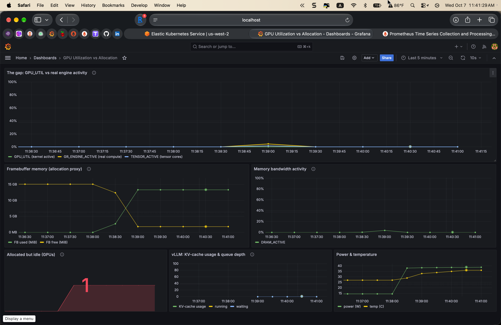

**Under load** - the same card driven by 24 concurrent inference streams. `GPU_UTIL` and the
graphics engine peg near 85%, but the **tensor cores** (`TENSOR_ACTIVE`) sit at ~13% while
**memory bandwidth** (`DRAM_ACTIVE`) climbs to ~70%. The workload is memory-bound, not
compute-bound: "GPU utilization" says the card is busy, the profiling counters say you are
paying for tensor cores you are not using. That divergence is the whole point.

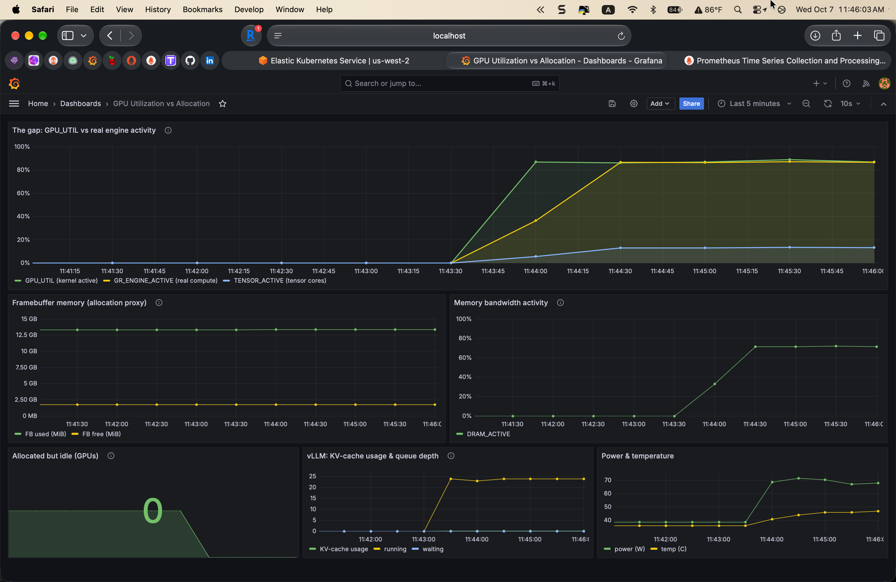

## Architecture

EKS in `us-west-2`, two managed node groups:

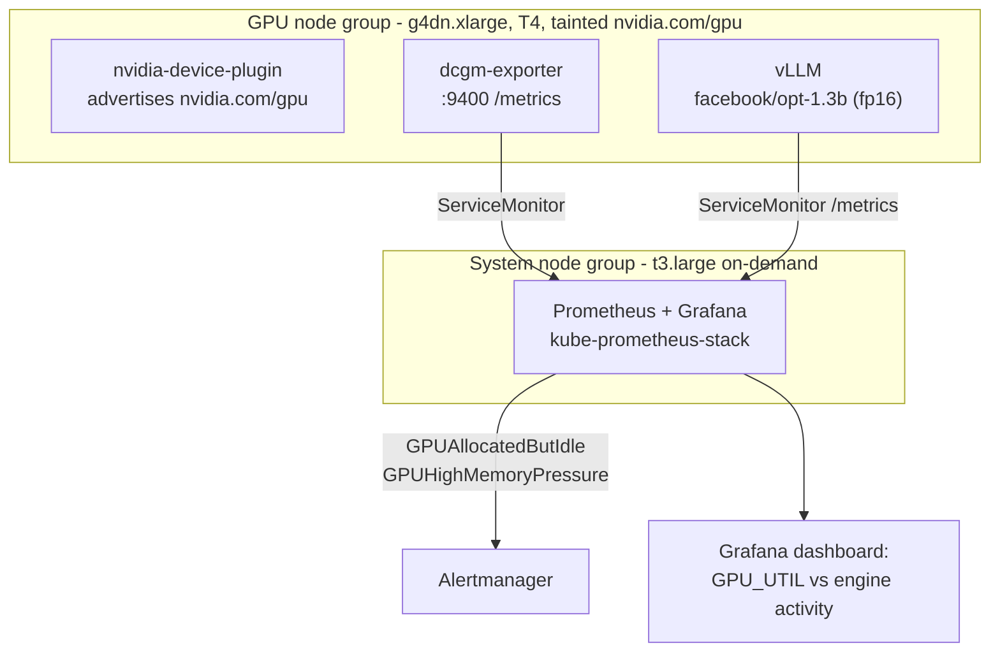

Driver and container runtime come from the EKS GPU-optimized accelerated AMI
(`AL2023_x86_64_NVIDIA`), which AWS builds and tests per Kubernetes version. Rather than the
full **GPU Operator** - whose driver lifecycle does not work cleanly on EKS AL2023 - the
cluster runs only the two pieces it actually needs against that host driver: the device
plugin (advertises `nvidia.com/gpu`) and dcgm-exporter (the Prometheus metrics source). The
operator dead-ends that led here are written up in [`docs/postmortem.md`](docs/postmortem.md).
Everything is scraped **in-cluster** - no external dependency, clone and apply.

## What's in here

| Path | What |
|------|------|
| `terraform/` | VPC + EKS, a CPU system pool and a spot GPU pool; nvidia-device-plugin + dcgm-exporter and kube-prometheus-stack via `helm_release` |
| `manifests/vllm/` | vLLM serving a small model, plus a ServiceMonitor for its Prometheus metrics |
| `manifests/loadgen/` | A Job that drives real inference load so the dashboards show activity |
| `manifests/dcgm/` | Optional custom DCGM counter set (adds `SM_ACTIVE`) |
| `manifests/time-slicing/` | Time-slicing config - software GPU sharing for the T4 (no MIG) |
| `manifests/alerts/` | `GPUAllocatedButIdle` and `GPUHighMemoryPressure` PrometheusRules |
| `dashboards/` | Grafana dashboard: the util-vs-allocation gap (auto-provisioned via a `grafana_dashboard` ConfigMap) |
| `docs/` | Architecture, the cost narrative, the apply/demo/destroy runbook, and the postmortem |

## Quickstart

Prerequisites: an AWS account with the **G/VT instance quotas** raised (spot and/or
on-demand - a fresh account has these at 0), `aws`, `terraform`, `kubectl`, `helm`, and
the remote-state backend bootstrapped (see [`bootstrap.md`](bootstrap.md)).

```bash
cd terraform
export TF_VAR_grafana_admin_password='<something strong>'
terraform init
terraform apply                       # ~15 min (EKS control plane dominates)

aws eks update-kubeconfig --name gpu-observability-demo --region us-west-2
kubectl get nodes -l workload-type=gpu
kubectl get node -l workload-type=gpu \
  -o jsonpath='{.items[0].status.allocatable.nvidia\.com/gpu}{"\n"}'   # should print 1

kubectl apply -f ../manifests/vllm/
kubectl -n workloads rollout status deploy/vllm --timeout=10m      # cold start: model load

# watch the gap (the dashboard is already provisioned)
kubectl -n monitoring port-forward svc/kube-prometheus-stack-grafana 3000:80
# open http://localhost:3000  ->  Dashboards  ->  GPU Utilization vs Allocation

kubectl apply -f ../manifests/loadgen/   # drive load, watch the gap open
```

Spot capacity is the default; if it is unfulfillable, apply on-demand with
`-var gpu_capacity_type=ON_DEMAND`. Full walkthrough, time-slicing demo, and teardown:
[`docs/runbook.md`](docs/runbook.md).

## vLLM serving metrics (v0.3)

The dashboard also surfaces the serving side of the GPU, not just the hardware side,
because an AI-infra SRE spends more time explaining tokens-per-dollar and TTFT than
`DCGM_FI_DEV_GPU_UTIL`. v0.3 adds four vLLM-serving panels on top of the DCGM ones,
plus four serving-quality alerts.

**The money shot: `1.1k` generation tokens/sec on a single T4** - with vLLM serving
`facebook/opt-1.3b` at 24 concurrent streams, this is the real throughput number the
cost conversation starts from. Divide by `$0.53/hr` on-demand (or `$0.16/hr` spot) for
a tokens-per-dollar figure.

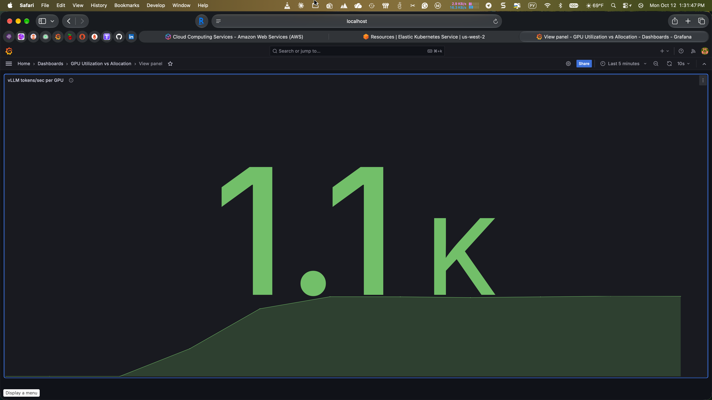

**Everything else, under the same load**: generation + prompt throughput, TTFT and E2E
latency percentiles, and the KV-cache/queue/swap signals all live together with the
hardware panels so a shift in any of them is interpretable alongside the others.

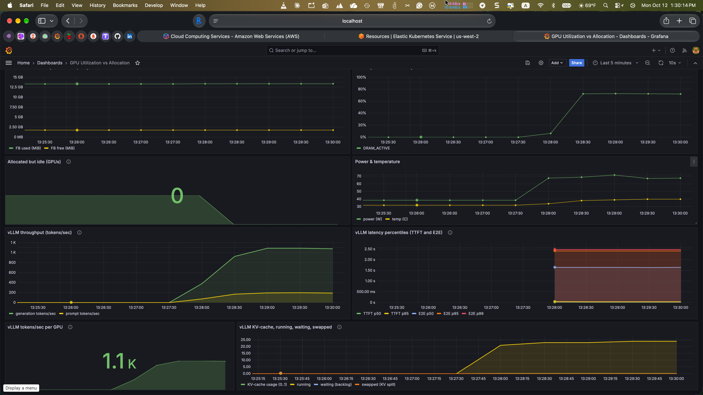

**Latency percentiles** - TTFT p50 and p95 sit near zero at the bottom (prefill is fast
on a small model), while E2E p50/p95/p99 spread across 1.6-2.5s, driven by the
24-concurrency generation workload. The widening between p50 and p99 is the signal to
watch under scale.

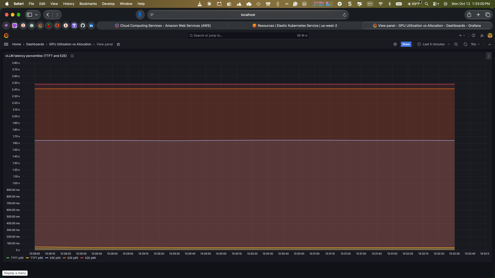

**Running queue depth** stabilizes around 24 - matching the concurrency vLLM admits
before the KV-cache binds. The dip is the loadgen Job restarting between runs; the
cliff back up is the scheduler ramping to steady state again within a few seconds.

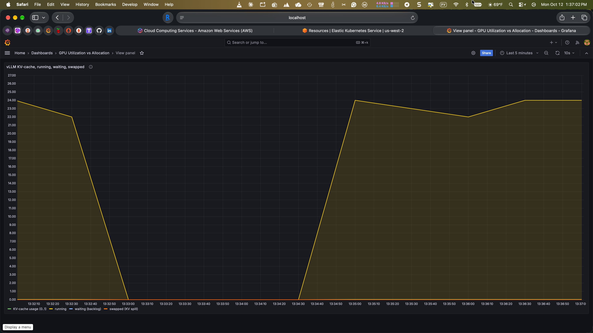

### What's in the v0.3 panels

- **Throughput** - `rate(vllm:generation_tokens_total[1m])` and prompt tokens/sec.
  The number every FinOps conversation about a serving fleet starts with.
- **Latency percentiles** - TTFT p50/p95 and E2E p50/p95/p99 via `histogram_quantile`
  over the vLLM histograms. TTFT = scheduler + prefill (what the user feels as
  "the model started answering"); E2E = full request.
- **tokens/sec per GPU** - a stat tile for serving efficiency. Divide by instance
  `$/hr` for tokens-per-dollar.
- **KV-cache + queue + swap** - `vllm:gpu_cache_usage_perc`, `vllm:num_requests_running`,
  `vllm:num_requests_waiting`, `vllm:num_requests_swapped`. KV-cache is the binding
  resource for vLLM throughput; `waiting > 0` or `swapped > 0` are the saturation
  signals.

### Serving-quality alerts

Alongside the DCGM-level `GPUAllocatedButIdle` / `GPUHighMemoryPressure`, four
serving-quality alerts in `manifests/alerts/vllm-serving-alerts.yaml`:

| Alert | Fires on | Why it matters |
|------|---------|---------------|
| `VLLMHighTTFT` | `job:vllm_ttft_seconds:p95 > 2s` for 5m | User-visible slowness; usually KV-cache near full |
| `VLLMQueueBackup` | `avg(vllm:num_requests_waiting[5m]) > 5` for 5m | Capacity undersized or admission unbounded |
| `VLLMKVCacheSaturated` | `vllm:gpu_cache_usage_perc > 0.95` for 5m | Next requests cannot schedule without swap |
| `VLLMSwappingUnderLoad` | `vllm:num_requests_swapped > 0` for 10m | Tail-latency killer; capacity decision point |

Record rules precompute `job:vllm_tokens_per_sec:rate1m`, `job:vllm_ttft_seconds:p95`,
and `job:vllm_e2e_seconds:p99` so dashboards and alerts share a single evaluation.

Together with the hardware panels this is the full "is this GPU being used **well**?"
picture: idle vs busy (DCGM), busy vs working (`GR_ENGINE_ACTIVE` vs `GPU_UTIL`),
working vs delivering (vLLM tokens/sec, TTFT), delivering vs cost-efficient
(tokens/sec per GPU).

## SLO burn rate and cost (v0.4)

v0.3 showed what the service is doing right now. v0.4 adds the two layers that
a Senior SRE audience actually wants to see: an SLO with a real error budget
and burn-rate alerts (SRE maturity), and a serving-cost line that connects
throughput to dollars (FinOps credibility).

**The headline cost number**: on a single `g4dn.xlarge` (one Tesla T4,
on-demand, no reservations) serving `facebook/opt-1.3b` under 24-stream load,
this stack reports **$0.137 per 1M generated tokens** at a steady ~7M
tokens/$ efficiency - directly comparable to the published inference rates on
OpenAI, Anthropic, Together and Groq.

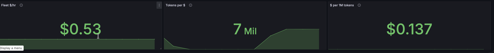

**Full v0.4 block under load**: the three new rows (SLO compliance, burn
rate, cost) sit directly under the vLLM serving panels on the same dashboard,
so a reviewer reads hardware → serving → SLO → cost in one top-down scroll.

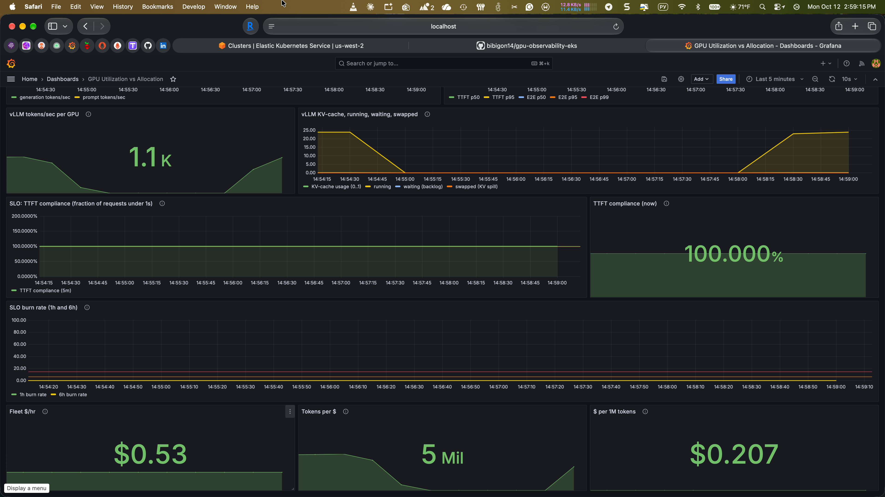

### SLO

**Target**: 99.5% of TTFT measurements at or under 1s, over a 30-day window.
That gives an error budget of 0.5% - about 3.6 hours of out-of-SLO time per
month. The SLI is request-level, computed from the TTFT histogram's `le=1.0`
bucket, so the dashboard panel and the alert expression share the same math.

| Record rule | What it is |
|------|------|
| `sli:vllm_ttft_compliance:ratio5m` | Fraction of TTFT measurements under 1s, 5m rolling |
| `slo:vllm_ttft_burn_rate:1h` | 1h burn rate against the 99.5% target |
| `slo:vllm_ttft_burn_rate:6h` | 6h burn rate against the same target |

**Burn-rate alerts** - the thing that makes an SLO actually operational.
Classic multi-window pattern from the Google SRE workbook, two tiers:

| Alert | Fires on | What it means |
|------|------|------|
| `VLLMTTFTBudgetFastBurn` | `burn_rate:1h > 14.4` for 2m | 2% of monthly budget spent in 1h - page-worthy |
| `VLLMTTFTBudgetSlowBurn` | `burn_rate:6h > 6` for 15m | 5% in 6h - ticket-worthy, usually a capacity signal |

In the screenshots the compliance ratio sits at 100% and both burn rates sit
at 0 - healthy state, consistent with TTFT staying well under 1s on a small
model. The threshold lines on the burn-rate panel make the alert boundaries
visible even when the service is nowhere near them.

### Cost

One config knob - `cost:gpu_hourly_usd` (default `0.526` for `g4dn.xlarge`
on-demand; `0.158` on spot). Swap the record rule value to match the fleet's
effective rate (reservations, savings plans, custom spot discounts).
Everything else derives from it and the GPU count the DCGM exporter reports.

| Record rule | What it is |
|------|------|
| `cost:gpu_hourly_usd` | Config: USD per GPU-hour |
| `cost:fleet_hourly_usd` | `cost:gpu_hourly_usd * count(GPUs)` |
| `cost:tokens_per_usd:rate1m` | Current generation throughput per dollar |
| `cost:usd_per_million_tokens:rate1m` | Inverse of above - directly comparable to the published rates on OpenAI, Anthropic, Together, Groq |

### What this lets a reviewer check in 30 seconds

Open the dashboard and the picture reads top-to-bottom as:

- Hardware: is the GPU doing anything at all (DCGM gap).
- Serving: how much, how fast (vLLM throughput, latencies).
- Promise: is the service meeting what we told users (SLO compliance,
  budget burn).
- Cost: what is the output worth (tokens per dollar, dollars per
  1M tokens).

The order is deliberate - it is the same order someone would ask about an
AI-serving system in an interview.

## HPA on queue depth + chaos (v0.5)

v0.4 added the SLO and the error budget. v0.5 closes two loops on top of it:
a horizontal autoscaler that reacts to the real capacity signal, and a chaos
experiment that proves the SLO burn-rate alerts actually fire when the
service is actually in trouble - not just when a dashboard looks pretty.

### KEDA ScaledObject on num_requests_waiting

The signal is `vllm:num_requests_waiting` - the live backlog of requests the
scheduler could not admit yet because the KV-cache is full. That is the only
honest capacity signal for an LLM server: `GPU_UTIL` and tokens/sec say
"the one GPU I have is busy", they do not say "I need more GPUs".
`num_requests_waiting > 0` does.

`manifests/autoscale/keda-vllm-scaler.yaml` wires a KEDA Prometheus trigger
at threshold 5 against `avg(vllm:num_requests_waiting)` with
`minReplicaCount=1`, `maxReplicaCount=2`, 15s polling and a 5m cooldown.
Cooldown is long on purpose - vLLM cold start is 2-5 min (image pull +
model weight download + VRAM load), so flapping on a metric that only
clears after a 5m cold start would starve the service.

To actually trigger a scaling event on `facebook/opt-1.3b` (the KV-cache
easily fits 96 concurrent streams on a T4), vLLM is deployed with
`--max-num-seqs=48` as a demo-only admission ceiling - with 96 workers in
the load generator this guarantees ~48 running and ~48 waiting, which is
well above the threshold. In a real multi-tenant serving fleet the ceiling
is natural (bigger models, longer contexts, more concurrent users); the
`--max-num-seqs` is just here so the demo closes the loop deterministically
on a tiny model.

**Scaling event in action** - KEDA observes the queue, HPA requests one more
replica, the second pod schedules on the second GPU node:

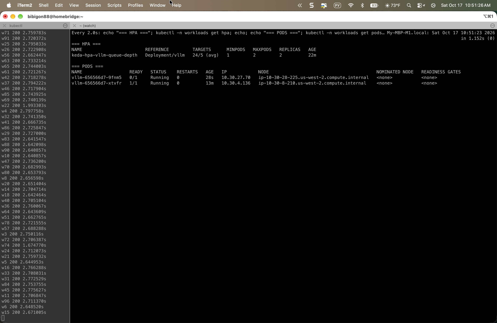

**Post-scale steady state** - both pods `1/1 Running` on separate GPU nodes,
queue drained from 24 to ~1.5 as combined admission capacity doubled, p95
response time dropped from ~2.7s to ~1.4s under the same load:


### Chaos: scheduled vLLM pod kill vs the SLO

`manifests/chaos/vllm-pod-killer.yaml` is a scoped `CronJob` + `Role` that
deletes a random vLLM pod every 5 minutes. ServiceAccount has only
`delete pods` in `workloads` namespace - no cluster-wide escalation.

With the autoscaled 2-replica serving layer, each kill drops the fleet to
one pod for the 2-5 min it takes the replacement to come back. During that
window the surviving pod gets 96 streams through a 48-slot admission ceiling,
`vllm:num_requests_waiting` spikes, TTFT goes over the 1s SLO budget, and
the burn-rate alerts fire.

The money shot - SLO compliance dropped from 100% to ~83% after the
second kill cycle, and the 1h burn rate climbed to ~30, crossing both the
slow-burn (6) and fast-burn (14.4) thresholds. Both `VLLMTTFTBudgetSlowBurn`
and `VLLMTTFTBudgetFastBurn` alerts are firing on this capture. The cost
tiles also tell on themselves: `tokens/$` dropped from 10M (steady state)
to 6M (one surviving pod carrying 96 streams through 48 slots), and
`$ per 1M tokens` doubled from $0.098 to $0.180 - chaos is visible in
the FinOps panel too.

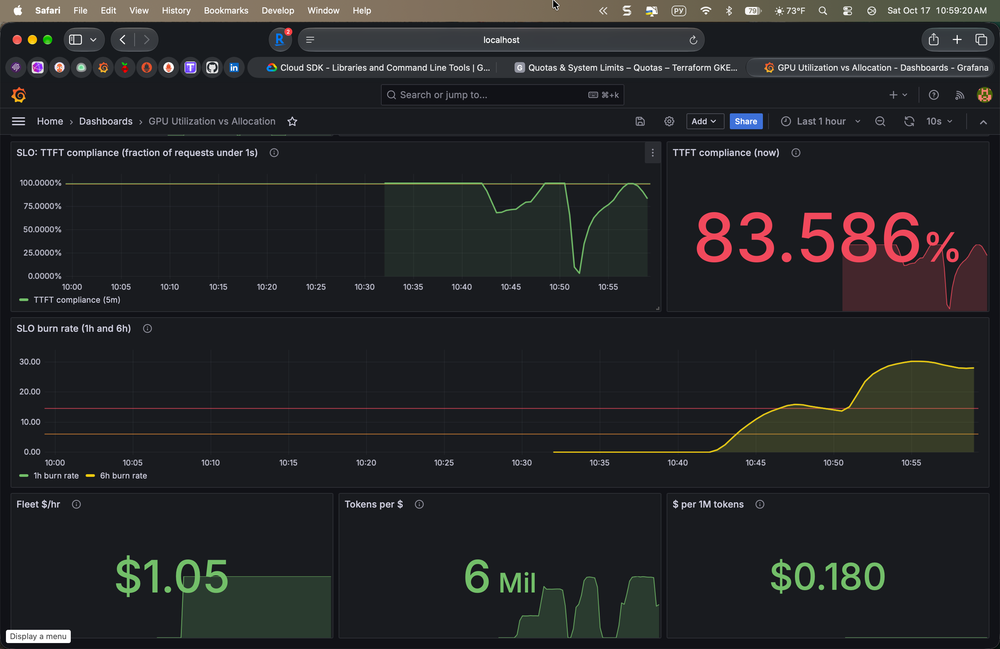

**For a production path** (not a demo) see
[chaos-scheduler-operator](https://github.com/bibigon14/chaos-scheduler-operator)
which does the same thing via a CRD with SLO burn-rate guardrails - the
operator auto-pauses chaos experiments when the budget is burning too fast,
so chaos itself can't push the service out of SLO.

### What this proves end-to-end

The hardware → serving → promise → cost ladder from v0.4 now has one more
column: the service responds to pressure (HPA scales) and the SLO responds
to failure (burn-rate alerts fire). Open the dashboard during chaos and the
whole story reads top-down:

- Hardware: GPU_UTIL spikes and dips as the killed pod's GPU idles then
  comes back (DCGM gap panels).
- Serving: throughput sawtooth, latency percentiles widen each cycle (vLLM
  panels).
- Capacity response: HPA adds a replica when the queue backs up (`REPLICAS: 2`).
- Promise: SLO compliance dips below 99.5%, burn rate crosses thresholds,
  alerts fire.
- Cost: `tokens/$` goes UP under chaos (two replicas share the load more
  efficiently per GPU-hour than one did).

## Teardown

```bash
kubectl delete -f manifests/vllm/ -f manifests/loadgen/
cd terraform && terraform destroy
```

## Cost

Spot `g4dn.xlarge` ~\$0.16/hr (on-demand ~\$0.53/hr) + EKS control plane \$0.10/hr + NAT.
A same-day apply/demo/destroy is a few dollars. The GPU pool can be set to `min_size = 0`
to scale to zero between demos.

## Notes / honest scope

This is a platform-reliability project, not model engineering. It owns scheduling,
observability, capacity, and the cost signal around GPUs. Kernel-level CUDA work,
distributed-training communication (NCCL), and fabric tuning (InfiniBand/RDMA) are out
of scope by design.
</content>
